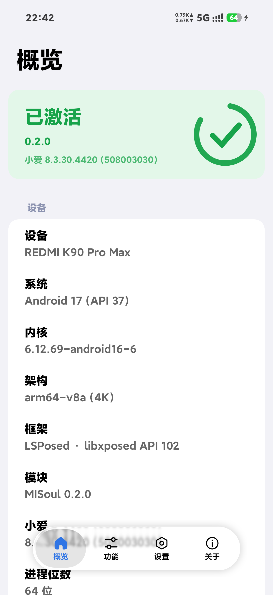
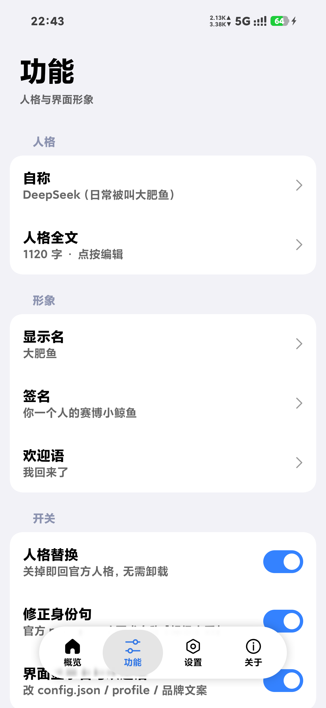
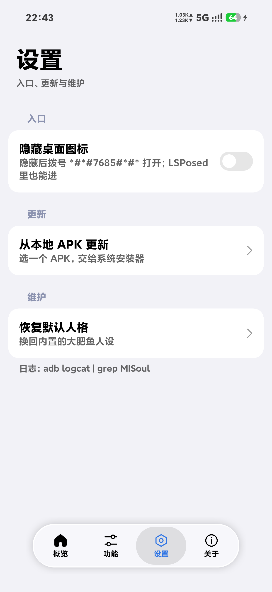
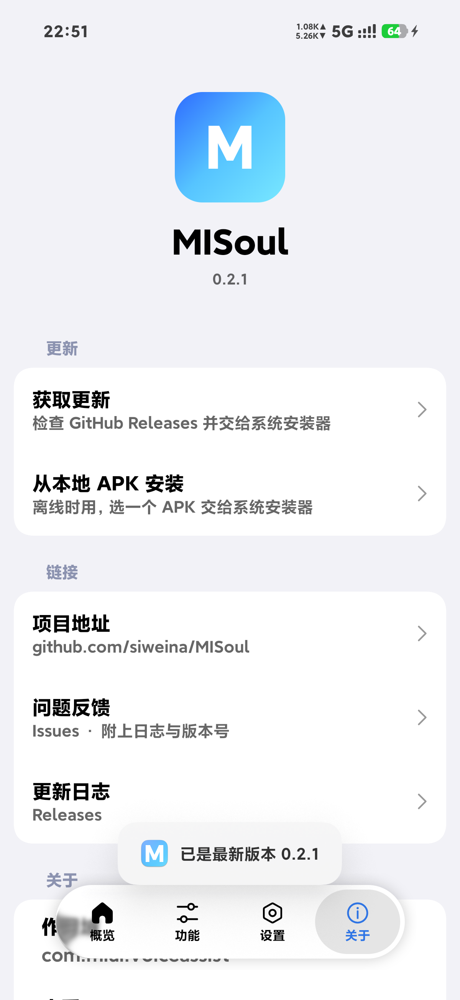

# MISoul

<div align="center">


</div>

把**超级小爱**的人格换成你自己的 —— 一个 LSPosed 模块。


不改小爱的任何文件、不重新签名 APK、不进 Recovery：模块只在 `com.miui.voiceassist` 的内存里把人格文本换掉。关掉开关就立刻回到官方人格，卸载即彻底消失。

<div align="center"></div>


<div align="center">
  
  
  
  
</div>
## 功能

- **人格全文**：用你自己的 `soul.md` 整份替换官方人设
- **自称**：定点替换官方 `prompt.md` 里「并表明自己是超级小爱」那一句，其余硬规则不动
- **界面形象**：显示名、签名、欢迎语（替换 `AgentProfile`），以及对话页顶部标题和开场语里的品牌文案
- **隐藏桌面图标**：隐藏后拨号 `*#*#7685#*#*`（S=7 O=6 U=8 L=5）收到一条通知，点通知进设置页；LSPosed 管理器里也能直接进
- **本地 APK 更新**：选一个 APK 交给设备自己的系统安装器，不自己开 `PackageInstaller` 会话
- 概览页自动读取机型、系统版本、内核、架构与页大小、进程位数、小爱版本

## 环境要求

| 项 | 要求 |
|---|---|
| 设备 | Android 13 及以上（minSdk 33），arm64 |
| 框架 | [LSPosed](https://github.com/LSPosed/LSPosed)（libxposed API 102） |
| 目标应用 | 超级小爱 `com.miui.voiceassist`（在 8.3.30.4420 / versionCode 508003030 上验证） |
| 作用域 | 只需勾选「超级小爱」 |

## 安装

1. 安装 [Releases](https://github.com/siweina/MISoul/releases) 里的 APK
2. 在 LSPosed 里启用 **MISoul**，作用域勾选「超级小爱」
3. **强行停止超级小爱**（LSPosed 提示「模块已更新」时也必须这么做），再打开
4. 打开 MISoul → 功能 → 人格全文，粘贴你自己的人格，保存

> 小爱进程只在启动时加载人格，改完不重启小爱看不到变化。

## 工作原理

模块通过 libxposed 挂在 `com.miui.voiceassist` 进程里，替换这几个位置：

| 目标 | 位置 | 用途 |
|---|---|---|
| `soul.md` / `prompt.md` 读取 | `rs.a$a.readAsset` / `readFile` | 人格文本 |
| `AgentProfile` 解析结果 | `ck.o0.l` / `ck.o0.m` | 显示名、签名、欢迎语 |
| `AgentDefinition.name` | `com.aios.osbot.agent.unified.AgentDefinition` | 声明式名字 |
| `config.json` 资源流 | `AssetManager.open` | 配置里的 `name` |
| 品牌文案 | `TextView.setText` / `Resources.getText` | 标题、开场语里的「超级小爱」 |

全部按**精确匹配**替换，命中不了就安静放过（小爱升级后最多是某处不生效，不会崩）。日志标签 `MISoul`：

```bash
adb logcat | grep MISoul
```

数据目录里小爱自己的文件不会被改，`soul.md` 仍是官方内容——替换只发生在内存里。

## 更新

关于页的「获取更新」会读取 [releases.atom](https://github.com/siweina/MISoul/releases.atom)（普通网页，不限流；不用 api.github.com，因为未登录的 API 按 IP 限流 60 次/小时），发现新版本就下载 APK 并交给系统安装器。

发布时请保持附件命名约定，否则自动更新拼不出下载地址：

```
MISoul-<tag>.apk     例如  MISoul-v0.2.1-beta.1.apk
```

离线时可以用「从本地 APK 安装」手动选择文件。
## 已知限制

- 混淆名（`rs.a`、`ck.o0`）随小爱版本变化，升级后需要适配；模块会记录 `hook skipped`
- 品牌文案是文本层替换，若官方改成 Compose 渲染或拼进长句，这一处会失效（其余不受影响）
- 拨号密令**不能直接弹出设置页**：后台广播里 `startActivity` 会被系统的 BAL 拦掉，所以用通知兜底
- 只支持 `com.miui.voiceassist`，不支持其他小爱版本线

## 构建

需要 JDK 21 与 Android SDK 37：

```bash
./gradlew :app:assembleRelease
```

产物在 `app/build/outputs/apk/release/app-release.apk`。release 构建开启了 R8 与资源压缩，体积约 3 MB。

## 许可

[MIT](LICENSE)

界面组件来自 [Miuix](https://github.com/compose-miuix-ui/miuix)（Apache-2.0），液态玻璃底栏改编自 [HyperNavBar](https://github.com/HyperNavBar/HyperNavBar) 与 [AndroidLiquidGlass](https://github.com/Kyant0/AndroidLiquidGlass)（均为 Apache-2.0），工程结构参考了 [HyperMusicCover](https://github.com/zyl6932/HyperMusicCover) 与 [InstallerX](https://github.com/iamr0s/InstallerX) 的做法（未复制其源码，后者为 AGPL-3.0）。

本项目与小米、小爱、DeepSeek 均无隶属关系。
